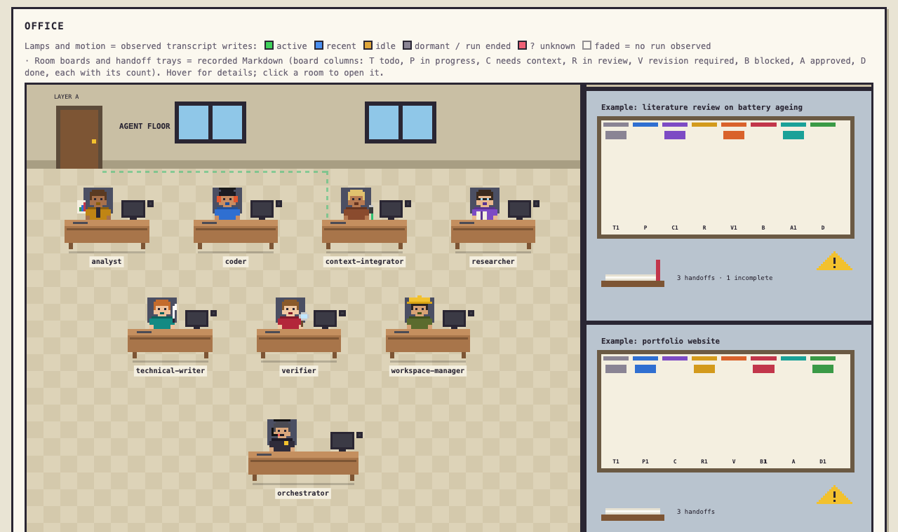

# Agent HQ

A small, **read-only** pixel-art dashboard for a multi-agent [Claude Code](https://docs.anthropic.com/en/docs/claude-code) workspace. It shows three things, and keeps them strictly apart:

- **Recorded status:** each project's task board and agent handoffs, read directly from your Markdown files.
- **Observed activity:** which agent is working right now, taken only from Claude Code transcript *metadata* (file times, tool names). No message content is kept or shown.
- **An office scene:** a desk per agent and a room per project. Characters move only when there is evidence of activity; nothing is animated for show.



*The included demo workspace. All projects, tasks and handoffs in it are example data.*

Standard library only, with no dependencies, build step, external fonts or CDNs. It listens on `127.0.0.1` only.

## Quick start

```bash
git clone https://github.com/gkasturirag12345-boop/agent-hq.git
cd agent-hq
python3 -B -m agent_hq.server --root examples/demo-workspace
# then open http://127.0.0.1:8780/ in your browser; stop with Ctrl+C
```

If port 8780 is already in use (for example, because the dashboard is already running for another workspace), choose another port and open that one instead:
```bash
python3 -B -m agent_hq.server --root examples/demo-workspace --port 8781
# open http://127.0.0.1:8781/
```

To use it on your own workspace, point `--root` at the folder that contains `PROJECTS/`:
```bash
python3 -B -m agent_hq.server --root ~/path/to/your-workspace
```
Live activity appears once Claude Code sessions have been run inside that folder; the demo workspace has none, so its office shows "no transcript folder — activity unknown".

Requires Python 3.9 or newer and a modern browser.

## Workspace layout it expects

```
your-workspace/
  .claude/agents/*.md                 # agent definitions; front matter: name, model, tools
  GLOBAL/PROJECT_REGISTRY.md          # optional table: | Slug | Title | Domain | Status | ...
  PROJECTS/<slug>/PROJECT.md          # marks a folder as a project
  PROJECTS/<slug>/TASK_BOARD.md       # table: | ID | Task | Owner | Status | Depends on | Latest handoff |
  PROJECTS/<slug>/HANDOFFS/*.md       # one file per agent handoff (YAML front matter, see below)
  PROJECTS/<slug>/CURRENT_STATE.md    # optional; its `updated:` date is shown
```

Handoff front matter:
```yaml
---
project: demo-website
task_id: W-002
agent: coder
date: 2026-01-10T14:30
status: COMPLETE            # the agent's own claim about its step
next_agent: verifier
task_board_update: "W-002 → IN_REVIEW (verifier)"
---
## Completed
## Evidence
## Unresolved questions
## Next agent must
```
A handoff is checked by `agent_hq/check_handoff.py`, which you can also run on its own: `python3 agent_hq/check_handoff.py --project <slug>`. It confirms the six front-matter fields are set and the four sections above are not empty.

Task statuses: `TODO` · `IN_PROGRESS` · `NEEDS_CONTEXT` · `IN_REVIEW` · `REVISION_REQUIRED` · `BLOCKED` · `APPROVED` · `DONE`.

## How to read it

| Badge | Meaning |
|---|---|
| **Recorded status** | exactly what `TASK_BOARD.md` says, with a `file:line` link |
| **Agent says…** | a handoff's own status; never treated as task completion |
| **Verified complete** | shown only for `DONE`, which in this workflow means human-approved |
| **Inconsistency** | e.g. a board status that disagrees with the latest handoff, a missing linked handoff, or a handoff that fails the checker. Listed, never corrected. |
| **observed: active / recent / idle / dormant / ended / unknown** | from transcript file times only; not progress |

Missing values are shown as "not recorded". Nothing is inferred or filled in.

## What it reads, and what it never reads

| Source (read-only) | Used | Never kept or returned |
|---|---|---|
| The workspace's Markdown files above | tables and front matter | — |
| `~/.claude/projects/<workspace path with non-alphanumerics as '-'>/` (this workspace only) | transcript file names (8 characters) and modification times | other projects' sessions |
| `…/<session>/subagents/agent-*.meta.json` | `agentType`, `finished` | every other field |
| `*.jsonl` transcripts written in the last 24 h, read incrementally | tool **name** and **timestamp** of `tool_use` records | message text, tool inputs and results, prompts, paths |

Live sessions are shown workspace-wide, because which project a session worked on is only recorded in its content. The cache is in memory only, and nothing is ever written to disk.

**Observed states:**
- **active:** written < 30 s ago.
- **recent:** < 5 min.
- **idle:** < 1 h.
- **dormant:** older.
- **ended:** the sub-agent's meta file says `finished`.
- **unknown:** not finished, with no writes for 5 min to 1 h.

A crashed run can still look `active` or `recent` for up to 5 minutes after its last write.

## The office
- One desk per agent found in `.claude/agents/`, plus the orchestrator (the main session) at the front. Sprites are original and drawn in code.
- **Driven only by observed data:** typing and a scrolling screen only while `active`; a lamp colour per state; a bubble with the last tool name; `?` for unknown; `zz` after an hour of no writes; faded when no run has ever been observed.
- When live data can't be read, a red banner says so instead of showing anyone as idle.
- **Project rooms** show recorded data: a task board (one note per task in its status column), a handoff tray (red edge if a handoff fails the checker) and a warning sign for inconsistencies. Click a room to open its project page.
- Hover anything for details, separated into OBSERVED and RECORDED. The same information is available as text below the office.
- Motion stops under `prefers-reduced-motion`; dark mode follows the system.

## Security
- Binds to `127.0.0.1` only, with no option to change it, and has no authentication. It's meant for your own machine. Don't put it behind a public proxy.
- Accepts GET and HEAD only; everything else returns 405.
- The `Host` header must be `127.0.0.1:<port>` or `localhost:<port>`, which blocks DNS rebinding.
- Static files come from a fixed whitelist. URL paths never reach the filesystem, and project slugs must match a discovered project. Symlinks are not followed.
- CSP `default-src 'self'`. All text is inserted with `textContent` or drawn on the canvas.

See [SECURITY.md](SECURITY.md) and [TESTING.md](TESTING.md).

## Tests
```bash
python3 -B -m unittest discover tests
```

## Licence
[Apache-2.0](LICENSE). The dashboard was designed and written from scratch; no code or art is taken from other dashboard projects.
